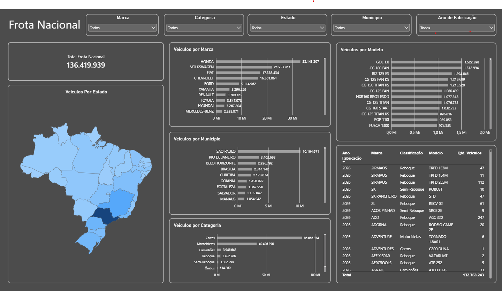

# Dashboard da Frota Nacional de Veículos — SENATRAN

Projeto de análise exploratória e visualização de dados da frota nacional de veículos, utilizando dados públicos disponibilizados pela Secretaria Nacional de Trânsito (SENATRAN).

O projeto tem como objetivo transformar uma base extensa de dados em informações acessíveis e interativas, permitindo analisar a distribuição da frota brasileira por estado, município, marca, modelo, categoria e ano de fabricação.

## 📊 Dashboard

<!-- Substitua pelo caminho da imagem de prévia do dashboard -->


O dashboard foi desenvolvido no Power BI, com filtros interativos e visualizações que permitem explorar os dados sob diferentes perspectivas.

## 🎯 Objetivos do projeto

- Explorar a distribuição da frota nacional de veículos.
- Tratar e padronizar inconsistências nos dados de marcas e modelos.
- Criar uma classificação de categorias de veículos não disponibilizada diretamente na base original.
- Otimizar o armazenamento dos dados tratados.
- Desenvolver um dashboard interativo para facilitar a análise das informações.

## 🗂️ Fonte dos dados

Os dados foram obtidos a partir dos arquivos públicos da frota nacional disponibilizados pela SENATRAN, com informações atualizadas até setembro de 2026.

**Fonte:** https://www.gov.br/transportes/pt-br/assuntos/transito/conteudo-Senatran/frota-de-veiculos-2026
- 01-Quantidade de Veiculos por UF Municipio Ano de Fabricação Modelo

> Para reproduzir o projeto, consulte a disponibilidade dos arquivos e utilize a base correspondente ao período informado.

## 🛠️ Tratamento e preparação dos dados

O processamento foi realizado em Python, utilizando Pandas e Jupyter Notebook.

A base original possui grande volume de dados e apresenta inconsistências na nomenclatura de marcas e modelos. Para preparar os dados para análise, foram realizadas etapas de limpeza, transformação e padronização.

### Principais etapas

- Leitura e exploração da base original.
- Separação das informações de marca e modelo, originalmente presentes em uma única coluna.
- Tratamento de diferentes padrões de nomenclatura e registros inconsistentes.
- Padronização da identificação das marcas e dos modelos.
- Classificação dos veículos em categorias para análise.
- Exportação dos dados tratados para o formato Parquet.

### Classificação dos veículos

Como a base original não disponibiliza a classificação utilizada no dashboard, foi desenvolvida uma regra própria de categorização, considerando as informações presentes nos registros.

As categorias adotadas são:

| Categoria | Descrição |
|---|---|
| Carros | Veículos leves, utilitários, SUVs, caminhonetes e pick-ups |
| Caminhões | Diferentes tipos de caminhões |
| Motocicletas | Diferentes tipos de motocicletas |
| Ônibus | Veículos destinados ao transporte coletivo de passageiros |
| Reboques | Carretinhas, trailers e outros reboques destinados a veículos de menor porte |
| Semirreboques | Veículos de carga, incluindo carretas |
| Reboques para motocicletas | Reboques destinados ao transporte por motocicletas |

A classificação foi construída para facilitar a análise e deve ser interpretada conforme os critérios adotados no processamento, não necessariamente como uma reprodução integral das classificações oficiais de trânsito.

## 📈 Funcionalidades do dashboard

### Indicador principal
- Contagem total de veículos, atualizada dinamicamente conforme os filtros e as seleções realizadas.

### Filtros interativos
- Marca;
- Categoria;
- Estado;
- Município;
- Ano de fabricação.

### Visualizações
- **Distribuição geográfica:** mapa por estado, com intensidade de cor proporcional à quantidade de veículos.
- **Veículos por marca:** comparação da quantidade de veículos entre fabricantes.
- **Veículos por município:** análise da distribuição municipal da frota.
- **Veículos por modelo:** exploração dos modelos registrados.
- **Veículos por categoria:** comparação entre os grupos de veículos definidos no tratamento.
- **Tabela de dados:** consulta detalhada dos registros conforme os filtros selecionados.

Os gráficos interagem entre si, permitindo selecionar uma marca, categoria ou outra informação e observar como os demais elementos do dashboard se ajustam à seleção.

## 💾 Otimização dos dados

Após o tratamento, a base foi exportada para o formato Parquet.

- **Arquivo original CSV:** aproximadamente 1,3 GB.
- **Arquivo tratado Parquet:** aproximadamente 124 MB.

Isso representa uma redução de aproximadamente **90,5% no tamanho do arquivo**.

A conversão facilitou o armazenamento e a organização dos dados tratados, mantendo uma estrutura adequada para utilização nas etapas posteriores da análise.

## 💻 Tecnologias utilizadas

- **Python:** processamento e transformação dos dados.
- **Pandas:** manipulação, limpeza e análise da base.
- **Jupyter Notebook:** desenvolvimento e documentação das etapas de tratamento.
- **Parquet:** armazenamento dos dados processados.
- **Power BI:** desenvolvimento do dashboard interativo.
- **DAX:** criação de medidas e indicadores.

## 📁 Estrutura do projeto

```text
frota-nacional-senatran/
├── README.md
├── notebooks/
│   └── tratamento_frota.ipynb
├── data/
│   ├── Categorias dos Veiculos.xlsx
│   ├── frota_final.parquet
│   
├── dashboard/
│   └── frota_nacional_senatran.pbix
└── images/
    └── dashboard_preview.png
```

Os arquivos de dados brutos e intermediários não são disponibilizados diretamente no repositório devido ao seu tamanho. A pasta `data/` deverá ser preenchida conforme as instruções de obtenção e processamento dos dados.

## ▶️ Como reproduzir o projeto

1. Clone este repositório.
2. Obtenha os dados públicos da frota de veículos da SENATRAN referentes ao período utilizado.
3. Coloque o arquivo CSV original na pasta indicada no arquivo `data/README.md`.
4. Instale as bibliotecas necessárias para executar o notebook.
5. Abra `notebooks/tratamento_frota.ipynb` e execute as etapas de processamento.
6. Utilize os dados processados para explorar o dashboard no Power BI.

Os caminhos dos arquivos e as dependências devem seguir as instruções documentadas no notebook e na pasta `data/`.

## 📌 Considerações finais

Este projeto reúne etapas de preparação, padronização, classificação, otimização e visualização de dados em um fluxo de trabalho de análise de dados.

Além da construção do dashboard, o trabalho envolveu a investigação de inconsistências na nomenclatura dos veículos e o desenvolvimento de regras próprias para tornar a base mais consistente e útil para análise.

O resultado é uma ferramenta interativa que permite explorar a composição e a distribuição geográfica da frota nacional de veículos.

---

**Projeto desenvolvido para fins de estudo e portfólio em Análise de Dados.**


